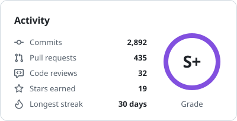
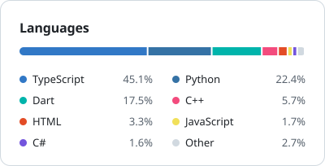

# Hi, I'm Muhammad Abdullah Saqib

I'm the CTO and Co-Founder of [Collabin](https://collabin.ai/), a marketplace that matches brands with the right creators. I build AI systems and the products around them, and at Collabin I've built the platform end to end, from the mobile apps to creator recommendations and campaign analytics.

I'm most interested in multimodal AI, intelligent agents and AGI.

## Jamming while I code

## GitHub stats

  <picture>
    <source media="(prefers-color-scheme: dark)" srcset="stats/activity-dark.svg">
    
  </picture>
  <picture>
    <source media="(prefers-color-scheme: dark)" srcset="stats/languages-dark.svg">
    
  </picture>

## Selected work

**[Authentica](https://ieeexplore.ieee.org/document/11577723)**, published in IEEE (ICIT 2026) 
Independent research on telling AI-generated content from real content. One framework checks both text and images, and it held above 95% accuracy on content it had never seen.

**[Mobile DRS](https://github.com/mabdullahsaqib/Mobile-DRS-System)** 
A cricket Decision Review System that gives an on-field verdict from video in under 10 seconds. I led the 30 developers who built it.

## Get in touch

[LinkedIn](https://linkedin.com/in/mabdullahsaqib) or [mabdullahsaqib2004@gmail.com](mailto:mabdullahsaqib2004@gmail.com)
